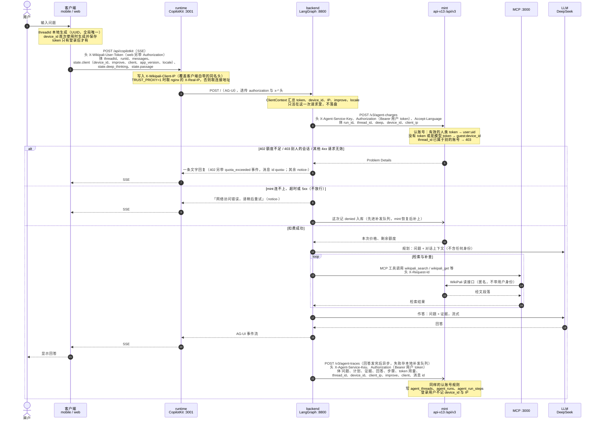
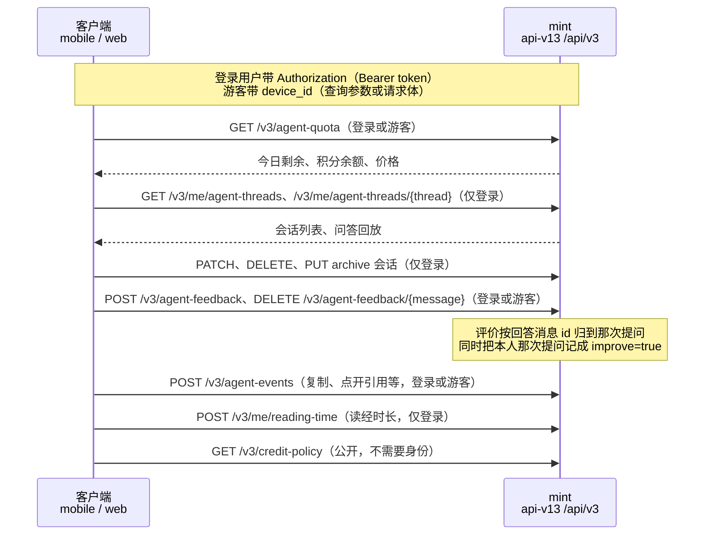

# 架构与数据流

> 设计文档。各服务的安装与运行方式见对应目录的 README。

## 1. 四层链路

```
浏览器 (web, Next.js)
   │  HTTP + SSE
   ▼
CopilotKit Runtime (runtime, Node)          :3001  /api/copilotkit
   │  AG-UI 协议 (POST /, SSE)
   ▼
LangGraph Agent (backend, Python/FastAPI)   :8800  POST /
   │  MCP Streamable HTTP
   ▼
WikiPali MCP Server (mcp, TypeScript)       :3000  /mcp
   │  HTTPS
   ▼
WikiPali API (www / next.wikipali.org)
```

| 层 | 目录 | 端口 | 对外入口 | 上游依赖 |
|---|---|---|---|---|
| 前端 | `web/` | 3000（`dev-up.sh` 用 3002） | `/` | runtime |
| Runtime | `runtime/` | 3001 | `/api/copilotkit` | backend |
| Agent | `backend/` | 8800 | `POST /`（AG-UI） | mcp、DeepSeek |
| MCP | `mcp/` | 3000 | `/mcp` | WikiPali API |

`dev-up.sh` 把 web 放在 3002，是为了避开 mcp 占用的 3000。

## 2. 数据流与用户识别

客户端是 App（wikipali-mobile）和网页（`web/`）。一次提问走 runtime → backend；额度、会话历史、评价等
由客户端直接调 mint（api-v13 的 `/api/v3`）。研究过程入库、额度、积分的规则见 [trace.md](trace.md)、
[credits.md](credits.md)。

### 2.1 一次提问



### 2.2 客户端直接调 mint



### 2.3 用户识别信息

| 信息 | 谁生成 | 怎么传 | 存在哪 |
|---|---|---|---|
| 登录 token | mint 登录时签发 | 客户端 → runtime：`X-Wikipali-User-Token`（web 另带 `Authorization`）；backend → mint：`Authorization: Bearer`；客户端直连 mint：`Authorization: Bearer` | 不存。mint 解出用户 uuid，记 `account_type = user`、`account_id = <uid>` |
| 设备匿名 id | 客户端首次使用时生成（mobile `src/user/deviceUuid`，web `localStorage["agent/device_id"]`） | AG-UI `state.client.device_id`；backend → mint 放请求体；客户端直连 mint 放查询参数或请求体 | 只对游客：`account_type = guest`、`account_id = <device_id>`。登录用户不记 |
| 客户端 IP | runtime（线上取 nginx 的 `X-Real-IP`） | runtime → backend：`X-Wikipali-Client-IP`；backend → mint：请求体 `client_ip` | 只对游客：`agent_runs.client_ip`、`credit_ledger.client_ip`（同 IP 每日上限） |
| 会话 id（threadId） | 客户端，UUID | AG-UI `threadId`；backend → mint：`thread_id` | `agent_threads.thread_id`，全局唯一，属于第一次用它的账号 |
| 消息 id | 用户消息由客户端生成，回答由 backend 生成 | AG-UI 消息；入库时带上；评价、隐式信号按回答消息 id 挂 | `agent_runs.user_message_id` / `assistant_message_id`，`agent_feedback.message_id` |
| 用于改进开关 | 用户在设置里选（默认开） | `state.client.improve` → 入库请求体 | `agent_runs.improve`（提问那一刻的值；评价过的提问改为 true） |
| 服务密钥 | 部署时配置（`AGENT_SERVICE_KEY`） | backend → mint：`X-Agent-Service-Key` | 不存。证明调用方是 agent 服务，入库与扣费接口只认它 |

要点：

- **身份只在 mint 判定**。runtime 和 backend 只负责转交，不解 token、不保存任何身份；LLM 和 MCP 拿不到身份信息。
- **模型 token 当游客处理**：对话归属、额度、积分只认人类账号。
- **游客的 IP 必须由 runtime 写**：客户端自带的 `X-Wikipali-Client-IP` 一律被覆盖，免得伪造 IP 绕过同 IP 上限。

## 3. 降级与可选依赖

| 缺什么 | 行为 |
|---|---|
| `DEEPSEEK_API_KEY` | backend 走内置 mock 演示模型（`mock_llm.py`），回答带「（mock 演示模式）」前缀 |
| MCP server 不可用 | backend 回退到内置 mock 检索工具 `retrieve_sutta_passage` |
| 无写端凭据 | 全链路降为纯读模式，读端 22 个工具无需凭据 |

因此仅启动 backend + runtime + web（不启动 mcp、不配 key）也能跑通演示。

## 4. 无状态原则

backend 与 mcp 都**不持久化任何凭据**：

- 不写文件、不读环境变量、不缓存、无会话状态；
- 凭据只在单次请求的生命周期内存在，请求结束即丢弃；
- token 由客户端持有，逐请求经 HTTP 头传递。

细节见 [凭据模型](./credentials.md)。

## 5. WikiPali 站点选择

`WIKIPALI_API_URL` 决定 mcp server 打哪个站点：

- `https://www.wikipali.org/api` —— 稳定版（默认），但 `/v2/case` 等端点会 500；
- `https://next.wikipali.org/api` —— 最新代码，**开发联调请用这个**（`dev-up.sh` 已默认）。
