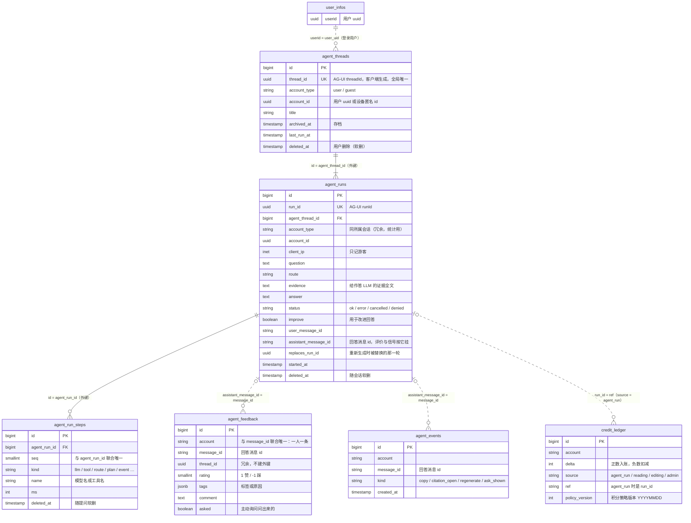

# 研究过程入库、会话历史与 web 渲染安全

> 设计文档。涉及 `mobile`（wikipali-mobile 仓库）/ `web` → `runtime` → `backend` → mint（api-v13）。
> 额度与积分另见 [credits.md](credits.md)。
> 实现：`backend/agent_trace.py`（入库）、`backend/mint.py`（与 mint 通信）、`backend/obs.py`（采集）、
> mint `App\Services\V3\AgentTraceService` / `AgentThreadService`、web `app/SafeMarkdown.tsx` 与 `middleware.ts`。

## 1. 记什么、记在哪

每次提问（一个 AG-UI run）结束后，backend 把整份研究过程送进 mint 的 Postgres。agent 部署的机器连不到
mint 的库，一律走 HTTP API。

| mint 表 | 一行是什么 | 要点 |
|---|---|---|
| `agent_threads` | 一个会话（AG-UI thread） | 归属 `account_type`（user / guest）+ `account_id`（用户 uuid / 设备 uuid）；`thread_id` 由客户端生成、**全局唯一**；`title` 取第一句提问；`archived_at` 存档；软删＝用户删除（提问、步骤随之软删） |
| `agent_runs` | 一次提问 | 问题、阅读页段落、路由 / 计划、给作答 LLM 的证据全文、回答、引用、token、耗时、状态（ok / error / cancelled / denied）、`improve`、AG-UI 消息 id、游客的 `client_ip` |
| `agent_run_steps` | 一步 | LLM 调用、工具调用（结果截断 8k，原长另记）、route / plan / retry / judge / passage / answer 节点事件、额度检查（event · quota） |

提示词只存版本哈希（`routing.PROMPT_VERSION`），不存全文。

### 1.1 表关联

实线是数据库外键（不级联删除，见 §4）；虚线是按值关联、没有外键。列只列键、身份与软删字段，完整字段见 mint 的 migration。



要点：

- **评价与隐式信号不挂外键**：它们按回答消息 id 记，可能比那次提问先到（入库是异步的），所以 `agent_runs` 那头是 0 或 1。
- **账号是贯穿各表的归属**：会话、提问、评价、信号、积分流水都用 `account_type`（user / guest）+
  `account_id`（用户 uuid / 设备匿名 id）两列（判定规则见 §2）。**两列必须一起用**：设备 id 是客户端填的，
  可以故意填成某个用户的 uid，只按 `account_id` 查就会把游客认成他。mint 里按账号查询一律走模型的
  `ownedBy()` scope（`App\Models\Concerns\OwnedByAgentAccount`），值对象是 `App\Services\V3\AgentAccount`。
- **软删联动**：会话 → 提问 → 步骤一起软删；评价、信号、积分流水不删，读评价时带出的问答会因提问已软删而为空。

mint 原有的 `chats` / `chat_messages`（2025-09 建、从未启用）**不用**：结构是「会话 → 消息」、
`user_id` 必填（游客存不了）、没有运行 / 步骤 / 过期字段，而且 v2 的 `/chats`、`/chat-messages` 接口
没有鉴权——往里写真实数据就等于公开。两张表原样留着，dashboard-v4 的 chatApi 仍引用它们。

## 2. 这次提问算谁的

```
App / web ──X-Wikipali-User-Token──▶ runtime ──▶ backend ──Authorization: Bearer <userToken>──▶ mint
          ──state.client{device_id, improve, client, app_version, locale}──────▶      + X-Agent-Service-Key
runtime 写 X-Wikipali-Client-IP（覆盖客户端自带的同名头）──────────────────▶      + body.client_ip
```

- **mint 认人，不信客户端自报**：有效的人类 token → 账号；没有 / 失效 / 是 AI 模型 token → 游客，
  靠设备匿名 id（mobile `getDeviceUuid()`；web 在 localStorage `agent/device_id` 生成一个）。
  token 失效也照记不拒——这批记录要用来防滥用。
- **游客必须有 IP**：同 IP 每日上限靠它，拿不到（绕过 runtime 直连 backend 等）backend 直接回「请求无效」，
  mint 扣费也对没有 IP 的游客回 422。评测脚本要打不连 mint 的 backend（见 `scripts/eval_routes.py`）。
- **IP 只记游客**。CopilotKit runtime 默认不转发 `X-Forwarded-For` / `X-Real-IP`，所以由 runtime 自己写
  `X-Wikipali-Client-IP`：线上 `TRUST_PROXY=1` 取 nginx 设的 `X-Real-IP`，直连时取 socket 地址。
- **游客登录后，之前的游客会话不并入账号**：客户端在登录 / 退出（换账号）时换一个新的 threadId，
  mobile 在账号变化时开新会话，web 登录后回到 `/agent/chat`。
- **threadId 全局唯一，属于别的账号就拒绝**（做法同 Vercel Chatbot 模板）：扣费 `POST /v3/agent-charges`
  带上 `thread_id`，已属于别的账号时 mint 回 403——backend 不跑、不扣费、不入库，只回一条文字说明
  （不发 `quota_exceeded`，客户端不会显示成额度用完）；入库 `POST /v3/agent-traces` 再兜一次 403。
  web 打开一个打不开的会话链接（别人的、已删除、写错）时自动开新会话。

## 3. 「用于改进回答」开关

App（我 → 设置 → AI 对话）与 web（输入框下方）都有，默认开。

**内测期间不允许关闭**：两端的 `IMPROVE_OPT_OUT_ALLOWED = false`（mobile `src/settings/ai.ts`、web `lib/session.ts`），
只留提示、不给关闭入口，`improve` 恒为 true；字段、入库、统计、digest 的过滤都不变。
TODO：在线用户协议写好后在提示里加协议链接，再决定是否放开。下面说的是放开以后的规则。

- 关掉**不是私密会话**：提问照样入库（会话历史 + 防滥用），只是这一次记 `improve=false`。
- 记的是提问那一刻的值，改开关只影响以后的提问。
- 改进回答、评测抽题、导出训练数据时一律跳过 `improve=false` 的记录。

## 3.1 用户评价与隐式信号

内测期收集改进数据，交互规则见 wikipali-mobile `docs/chat.md` §6.6（web 同一套，`web/lib/feedback.ts`）。

| mint 表 / 字段 | 内容 |
|---|---|
| `agent_feedback` | 一人对一条回答一行（唯一键 account + message_id）：`rating` ±1、`tags`（点赞标签或点踩原因）、`comment`（只跟「其他」走）、`asked`（主动询问问出来的，一旦为真就不再改回）、`client` |
| `agent_events` | 隐式信号：`copy` / `citation_open` / `regenerate` / `ask_shown`，只追加 |

接口：`POST /v3/agent-feedback`、`DELETE /v3/agent-feedback/{message}`、`POST /v3/agent-events`（游客带 `device_id`）；
管理：`GET /v3/admin/agent-feedback`、`GET /v3/admin/agent-runs/digest`。

**digest**（精简导出，给 agent 做问题聚类与改进分析）只含 `improve=true` 的提问、不含任何身份，
每行带路由、关键词、工具耗时、评价、隐式信号、同会话下一句的间隔（判断换说法重问）；
`full=1`（`wikipali admin digest --full`）时再带回答、证据全文与引用。
**mint 不做回答质量评估**（曾经入库时自动算过，2026-11 去掉）：由 agent 拉这些数据自己评，见 improve-answers 技能。
命令行：`wikipali admin digest`（wikipali-plugins）；分析流程：`.claude/skills/improve-answers/SKILL.md`；
回归评测：`backend/scripts/eval_routes.py --from-digest`。

**评价即同意用于改进**：客户端在「用于改进回答」关着时先弹窗征得同意（不同意就不能评价），所以 mint 收到评价时把
本人那次提问改记 `improve=true`（`AgentFeedbackService::rate()`）；评价先到、研究过程后到时在入库那一刻补上
（`AgentTraceService::record()`）。

游客的评价与信号同样永久保留（见 §4）。


## 4. 保留与删除：数据永久保留，只有软删

研究过程、会话、评价、隐式信号**一律永久保留**，没有定期清理（原来的 `agent:prune-traces` 已删除，游客数据也不再过期）。

- **软删除**：`agent_threads`、`agent_runs`、`agent_run_steps` 都有 `deleted_at`。用户删除会话时，会话连同它的
  提问、步骤一起软删（`AgentThreadService::hide()`，一个事务）。
- **软删后任何接口都读不到**：会话历史、管理后台的提问记录 / 详情 / 统计 / digest、评价审阅（评价本身还在，
  只是不再带出那次问答），将来的分享对话也一样。Eloquent 靠 `SoftDeletes` 自动过滤；直接用 `DB::table('agent_runs')`
  或 join `agent_run_steps` 时要自己加 `whereNull('deleted_at')`。
- **外键不级联**（没有 `cascadeOnDelete`）：数据库层面不做任何真删除，真删一个还有提问的会话会被外键拦下。
- agent 端补发一条已被软删的提问：mint 认出它已存在（200），不会重建或复活。

## 5. 入库的可靠性

- `agent_trace.submit()` 在运行结束后后台发送，不阻塞也不影响对话；mint 按 `run_id` 幂等。
- 发不出去（网络、超时、5xx、401）就追加到 `logs/trace-spool.jsonl`（`TRACE_SPOOL`），下一次发送成功后
  顺带补发；422（数据本身有问题）只记日志不进队列。
- `AGENT_MINT_API_URL`（缺省 `WIKIPALI_API_URL`）或 `AGENT_SERVICE_KEY` 没配就整段跳过——**仅限本地**。
  线上部署后看 backend `/health` 的 `trace_enabled` 必须是 `true`。

## 6. 会话历史（web 与 mobile 共用）

只给登录用户（游客的设备 id 不是秘密，不能凭它读历史）。接口：

| 接口 | 用途 |
|---|---|
| `GET /v3/me/agent-threads?filter[archived]=` | 列表，最近提问在前 |
| `GET /v3/me/agent-threads/{thread}` | 详情：可见的问答轮次（被「重新生成」替换的不返回），不含研究过程 |
| `PATCH /v3/me/agent-threads/{thread}` | 改标题 |
| `PUT` / `DELETE /v3/me/agent-threads/{thread}/archive` | 存档 / 取消存档 |
| `DELETE /v3/me/agent-threads/{thread}` | 删除（软删，返回 200 + 资源） |

**续聊**：backend 的对话状态在内存（`MemorySaver`）里，重启就没了。客户端打开历史会话时，按入库时记下的
AG-UI 消息 id 把问答回灌给 agent、`threadId` 换成那个会话的；ag-ui-langgraph 在内存里找不到这个 thread
时以客户端送来的消息为准。已在 Waydroid 上验证：重启 backend 后打开旧会话追问，回答接得上。

**重新生成**：客户端把最后一个问题再问一遍，这一轮在 `state.client.replaces_message_id` 里带上被替换那条回答的
AG-UI 消息 id（只对这一轮有效，下一次提问前清掉）；backend 原样放进入库请求，mint 在同一会话里换算成
`replaces_run_id`。会话历史回放时被替换的那一轮不再返回（`AgentRun::scopeVisible`）。

web 的地址跟着会话走：`/agent/chat/<threadId>`——**只对登录用户**；游客没有历史接口，地址栏不带会话 id，
免得刷新后打不开。

## 7. web 渲染安全

web chat 部署在 `next.wikipali.org/agent`，与 dashboard-v6（`/pcd-v2026/`）同源：登录 token 在同源
storage 里共用，dashboard-v6 登录页的回跳也只接受同源地址。代价是这个页面上任何一段被注入的脚本都能读到
主站 token。回答来自 LLM，而 LLM 读的工具结果里有任何人都能写的批注、译文、术语——必须当不可信输入。

| 层 | 做法 |
|---|---|
| 渲染 | `SafeMarkdown` 是回答、思考过程、历史回放的唯一入口（配置在 `lib/markdownPolicy.mjs`）：不解析原始 HTML；链接只许 http / https / mailto，外站链接标出域名、`rel="noopener noreferrer nofollow ugc"`；图片只许受信站点、不许 `data:`；mermaid 降级为普通代码块；引用卡片的链接也过同一道检查。用户的提问、会话标题一律纯文本 |
| CSP | `middleware.ts` 每请求一个 nonce：`script-src 'self' 'nonce-…' 'strict-dynamic'`、`img-src` 只放受信站点（堵住用图片把对话带出去）、`object-src 'none'`、`frame-ancestors 'none'` 等；默认 Report-Only，观察几天没有误伤后设 `CSP_ENFORCE=1` |
| 依赖 | `@copilotkit/*`、`streamdown` 锁精确版本；CopilotKit 浏览器遥测关闭（`COPILOTKIT_TELEMETRY_DISABLED`），dev 面板 / web inspector 关闭（它们会去外站拉字体和公告） |
| 回归 | `npm run check:xss`：26 个载荷跑同一条管线，升级依赖、每次部署前都跑 |

本地 headless Chromium 验证过：把含脚本、外链图片、`javascript:` 链接、伪装成经文链接的外站地址、
恶意标题的会话写进库再打开，脚本不执行、没有任何请求发往外站、CSP 零报告。

> **TODO（长期）**：根治要让 mint 改用 HttpOnly cookie 保存登录态（脚本读不到），牵涉主站登录体系，
> 单独立项。在那之前，同源的任何 XSS（包括 dashboard-v6 自己的）都能读到 token。

## 8. 部署清单（ops）

- mint `.env`：`AGENT_SERVICE_KEY=<随机长串>`（`openssl rand -hex 32` 生成）；每天跑 `credits:settle-activity`。
- backend 环境：`AGENT_MINT_API_URL=https://next.wikipali.org/api`、同一个 `AGENT_SERVICE_KEY`；
  确认 `/health` 里 `trace_enabled: true`。（`QUOTA_FAIL_OPEN` 已删除：mint 不可用时不再放行，见 credits.md。）
- runtime 环境：`TRUST_PROXY=1`。
- **`AGENT_SERVICE_KEY` 的保管**：只放 mint 与 backend 两处，不能出现在 runtime、web、mobile 的配置或代码里
  （runtime 用不到它，客户端更不能有）。拿到它就能冒充 backend：替任意账号扣费、写入任意提问记录。
  泄露或换人运维时两边一起换，换完确认 backend `/health` 仍是 `trace_enabled: true`。
- 本地开发：backend 不配它就不扣费、不入库（`trace_enabled: false`，`dev-up.sh` 会提示）；
  要联调额度与入库，就在 `backend/.env` 配上与本机 mint `.env` 相同的值。
- web 构建：`NEXT_PUBLIC_RUNTIME_URL=https://next.wikipali.org/agent/api/copilotkit`；
  `NEXT_PUBLIC_MINT_API_URL`、`NEXT_PUBLIC_DASHBOARD_URL` 线上留空（同源默认 `/api`、`/pcd-v2026`）。
- nginx（next.wikipali.org）：

```nginx
# runtime 写在 web 前面：/agent/api/copilotkit 归 runtime，其余 /agent/ 归 web（Next.js，basePath=/agent）
location /agent/api/copilotkit {
    proxy_pass http://127.0.0.1:3001/api/copilotkit;
    proxy_set_header X-Real-IP $remote_addr;      # runtime 据此写 X-Wikipali-Client-IP
    proxy_set_header Host $host;
    proxy_http_version 1.1;
    proxy_buffering off;                          # SSE 流式输出
    proxy_read_timeout 300s;
}
location /agent/ {
    proxy_pass http://127.0.0.1:3002;
    proxy_set_header Host $host;
    proxy_set_header X-Real-IP $remote_addr;
}
# backend（8800）、MCP（3000）不对外
```
